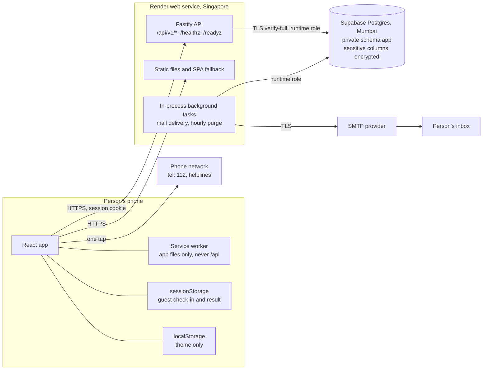
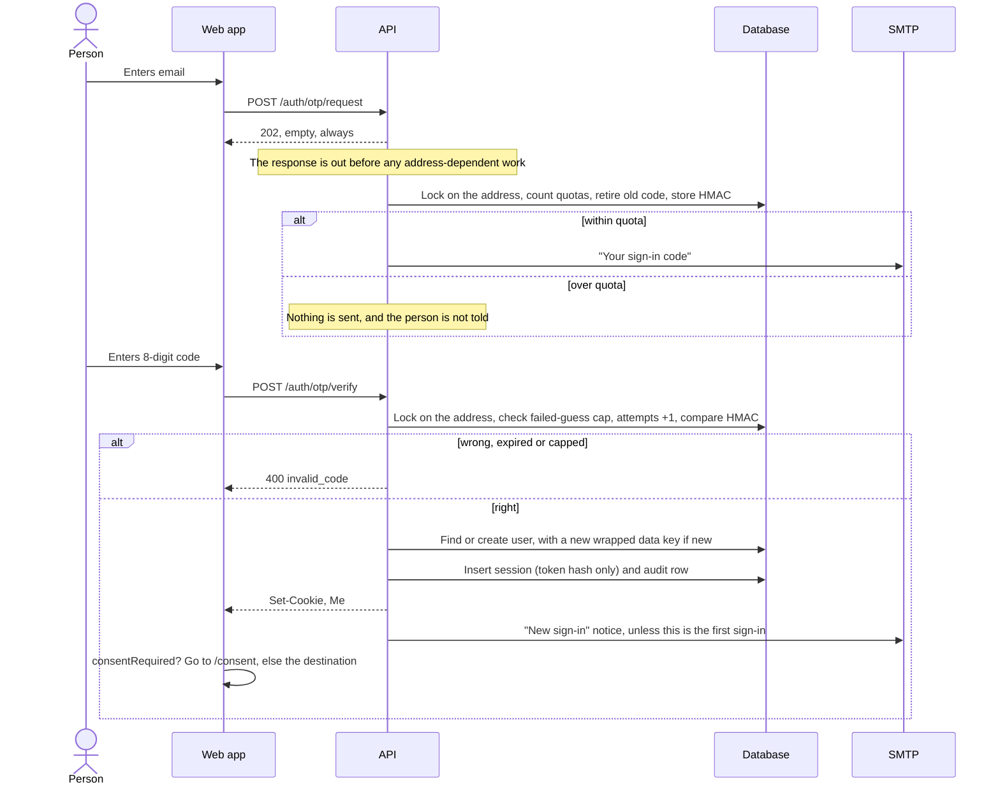
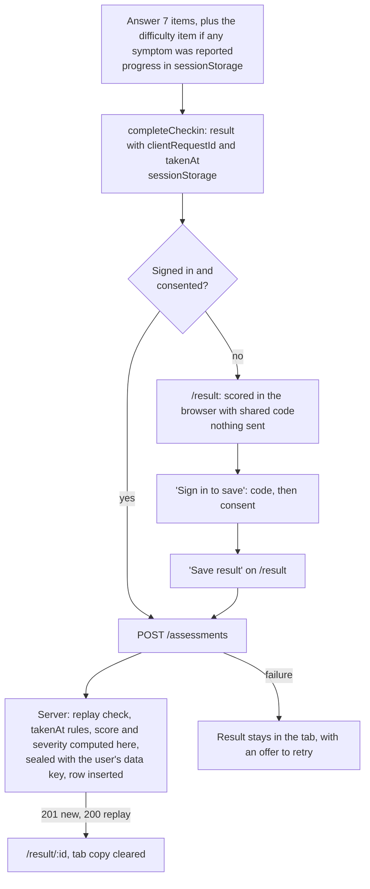
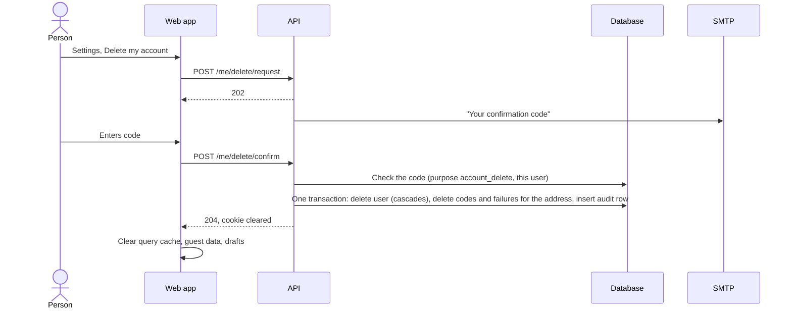

# Architecture

Status: not deployed. The hosting parts below describe what [render.yaml](../render.yaml) and [.env.example](../.env.example) set up. They have not run on Render, Supabase or a real SMTP provider.

## System

One Node process serves both the API and the built web app. Everything else is a dependency of that process. The browser only ever talks to one origin.

| Package | Job |
| --- | --- |
| [`packages/shared`](../packages/shared/README.md) | GAD-7 wording and scoring, helplines, Zod schemas, CSRF header name. Both apps import it. |
| [`apps/api`](../apps/api/README.md) | Routes, auth, encryption, mail, purge, config, static serving. |
| [`apps/web`](../apps/web/README.md) | The React PWA. |

Why these shapes: [single origin](decisions/002-single-origin.md), [Supabase as plain Postgres](decisions/003-supabase-as-plain-postgres.md), [PWA first](decisions/006-pwa-first.md).

## Request lifecycle

The order comes from the hook registration in [apps/api/src/app.ts](../apps/api/src/app.ts).

| Step | What happens | If it fails |
| --- | --- | --- |
| 1. Request ID | A random UUID, returned in every error body. | |
| 2. Default headers | `cache-control: no-store`, with `no-transform` on `/api`, `permissions-policy`, then Helmet (CSP, HSTS, and others). | |
| 3. Cookie parsing | `@fastify/cookie`. | |
| 4. CSRF | Anything except GET and HEAD needs an allowed `Origin` and `x-anxiocare-csrf: 1`. | 403 `csrf_failed`. Not counted by the limiter. |
| 5. Rate limit | Per client: a route limit if the route has one, otherwise the global budget. | 429 `rate_limited` |
| 6. Body parse | JSON only, 64 KB at most. An empty JSON body counts as no body. | 400, 413 or 415 `validation_failed` |
| 7. Auth | `requireAuth` loads the session by the hash of the cookie token, on routes that need it. | 401 `unauthenticated` |
| 8. Consent | `requireConsent` compares the user's consent version with the current one, on data routes. | 403 `consent_required` |
| 9. Handler | Zod parses the body and query. Queries are scoped by `user_id`. Data is sealed on the way in and opened on the way out. | 400 `validation_failed`, 404 `not_found`, 409 `conflict`, 400 `invalid_code` |
| 10. Response log | One line: method, route template, status, duration, request ID. Nothing else. | |
| 11. Background | Mail and similar work runs after the response, so it cannot affect timing. | Logged with no details; the person sees nothing. |

Any uncaught error becomes a 500 `internal_error` with no internal detail. Unmatched paths go to the not-found handler. A page navigation gets `index.html`, and everything else gets a 404 problem document. See [API foundation](modules/api-foundation.md).

## Data flow: sign-in

Sign-up and sign-in are the same path. The account row is created only at the first successful verify, so nothing on the request path can reveal whether an account exists.

Details: [auth and sessions](modules/auth-and-sessions.md), [email](modules/email.md), [decision 010](decisions/010-eight-digit-codes-and-quotas.md).

## Data flow: check-in

A guest check-in never leaves the browser. A signed-in person's result is saved at the end. A guest's result can be saved after sign-in, for up to 24 hours.

The client cannot send a score: the schema rejects unknown keys. A retry with the same `clientRequestId` returns the original row. Details: [check-in and scoring](modules/check-in-and-scoring.md).

## Data flow: erasure

After this:

- `users`, `sessions`, `consents`, `assessments` and `journal_entries` rows are gone, including the wrapped data key.
- Only `audit_log` rows remain. They hold an HMAC of the old user ID, an action and a day, and age out after a year.
- Encrypted database backups keep a copy until they age out, `BACKUP_RETENTION_DAYS` later. Until then, a backup plus the master key can still decrypt it. The app states this to the person.

Details: [consent and privacy rights](modules/consent-and-privacy-rights.md).

## Trust boundaries

| Boundary | What crosses it | What protects it | What it does not protect against |
| --- | --- | --- | --- |
| Browser to server | Cookie, JSON | TLS, HSTS, `__Host-` cookie, SameSite=Strict, CSRF checks, Zod with unknown keys rejected, CSP | A compromised phone, or a borrowed unlocked phone |
| Person to person | Any `:id` | Every query filters on the session's `user_id`. Other people's rows return 404. | RLS does not do this: policies are `USING (true)`. See [decision 005](decisions/005-rls-role-scoped-policies.md). |
| App to database | SQL, ciphertext | TLS verify-full with a pinned CA, least-privilege role, private schema, boot check on the role | The app process can read everything it needs, by design |
| Database to anyone reading it | Rows and backups | Encrypted columns, padding to hide lengths, blind indexes | Someone who has both the database and `ENCRYPTION_KEYS`. Ids, timestamps and row counts are in plaintext. |
| Server process | Master keys, plaintext while in use | Environment variables only. `DATABASE_MIGRATION_URL` is removed before serving. Logs are allow-listed. | Anyone with Render shell or settings access. See [docs/SECURITY-EXCEPTIONS.md](SECURITY-EXCEPTIONS.md). |
| Server to SMTP provider | Address and message text | TLS required, neutral wording, no health content | The provider can read addresses and codes |
| Edge to server | `cf-connecting-ip`, `X-Forwarded-For` | `CLIENT_IP_HEADER`, `TRUST_PROXY_HOPS` | Forged client addresses if these are misconfigured. Not verified on live Render. |
| Browser to helpline or website | `tel:` and links the person taps | They are links, not loads. Nothing is fetched from another host. | What those services see once a person uses them |

The threat analysis is in [docs/THREAT-MODEL.md](THREAT-MODEL.md).

## Key design decisions

| Decision | Short reason |
| --- | --- |
| [Email codes, no passwords](decisions/001-email-codes-instead-of-passwords.md) | No password store to lose. |
| [Single origin](decisions/002-single-origin.md) | Strict cookies and CSRF stay simple. |
| [Supabase as plain Postgres](decisions/003-supabase-as-plain-postgres.md) | The owner chose Supabase. Its auto-generated API cannot reach a private schema. |
| [Application-layer encryption](decisions/004-application-layer-encryption.md) | A database dump alone reveals no health data. |
| [Role-scoped RLS](decisions/005-rls-role-scoped-policies.md) | The runtime role needs no `BYPASSRLS`, and other roles see nothing. |
| [PWA first](decisions/006-pwa-first.md) | No app store between a person and Help. |
| [Exact GAD-7](decisions/007-exact-gad7.md) | Changing a validated instrument invalidates it. |
| [No third-party analytics](decisions/008-no-third-party-analytics.md) | Mental health browsing data stays with the person. |
| [Guest check-in](decisions/009-guest-check-in.md) | A person in distress should not have to make an account. |
| [Eight-digit codes and quotas](decisions/010-eight-digit-codes-and-quotas.md) | The limits hold even with several server instances. |
| [Hand-built SVG chart](decisions/011-hand-built-svg-chart.md) | Small, accessible, and it fits the strict CSP. |

## Single-instance assumption

`render.yaml` defines one instance, and some things assume that:

- Rate limits are in each process's memory and reset on restart. With N instances, an attacker gets N times the budget. The quotas in Postgres still hold.
- Background mail lives in memory. A crash after the 202 and before delivery loses that mail.
- The purge timer is in-process. Several instances running it is harmless, because it is idempotent.
